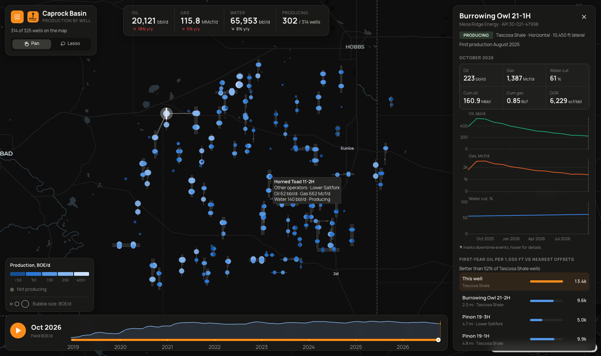

# Basin Production Map

A map-first view of oil, gas and water production for every well in the **Caprock Basin**,
a made-up basin of 325 wells run by three operators and a handful of smaller ones. The map
fills the screen; everything else floats on top of it. Scrub or play through almost eight
years of monthly production to watch the basin get drilled up and decline. Color the wells
by what matters to you, lasso an area to see what it makes, or click a well to see how it
compares with its neighbours.



## What it shows

- **The map**: every well on production in the month shown, sized by BOE/d and colored by
  the measure you pick. Horizontal laterals are drawn from heel to toe. Switch to a
  **heat map** to see where production is concentrated, or turn on pipelines, the gas plant,
  the crude terminal and the tank batteries.
- **Color by**: this month's production, oil rate, gas rate, water cut, gas-oil ratio or
  status; or by first-year oil per 1,000 ft of lateral (where the good rock is), first
  production year, operator or formation.
- **Production totals** for the month and the change from a year earlier.
- **Timeline**: field BOE/d over time. Drag the slider, click the chart to jump to a month,
  or press play.
- **Side panel**, depending on what is selected:
  - *Field*: totals, production by formation over time, the top producers this month and
    production by operator.
  - *Selected area* (lasso): the same breakdown for just the wells you circled.
  - *Well*: rates and cumulative volumes, oil, gas and water cut history with workovers and
    shut-ins marked, and first-year oil per 1,000 ft against the five nearest horizontal
    offsets, which are linked to the well on the map.

## Controls

The **menu button** (top left) opens a drawer with all the settings. The map stays live
while the drawer is open, so you see each change as you make it.

| Control | What it does |
| --- | --- |
| Color wells by | The measure that colors the wells |
| Bubble size | Size by BOE/d, or make all wells the same size |
| Map view | Wells or heat map |
| Basemap | Dark, light or satellite imagery |
| Layers | Horizontal laterals; pipelines and facilities |
| Operator, formation, well type | Filter the wells |
| Status in the month shown | Producing, shut in, plugged |
| First production year | Filter by vintage |

On the map itself, **Pan / Lasso** switches between moving the map and drawing a selection.
Scroll to zoom.

## The data

`basin.py` generates everything. 74 pads of 2 to 6 horizontal wells drilled into three
stacked benches, and 34 older vertical wells. Rock quality varies across the basin with a few
sweet spots, which get drilled first, and the wells get gassier to the west. Each well follows
an Arps hyperbolic decline with a choke-managed first two months and a rising gas-oil and
water-oil ratio. The record also includes workovers, shut-ins while an offset pad within a
mile and a half is fracked, curtailments in 2020, wells shut in at the end of the record, and
verticals that are plugged and abandoned.

The basin, operators, leases and wells are all made up.

## Run it

```bash
pip install -r requirements.txt
python app.py
```

Then open http://127.0.0.1:8061.

Built with [Dash](https://dash.plotly.com/), [Plotly](https://plotly.com/python/) and
[Dash Mantine Components](https://www.dash-mantine-components.com/).
