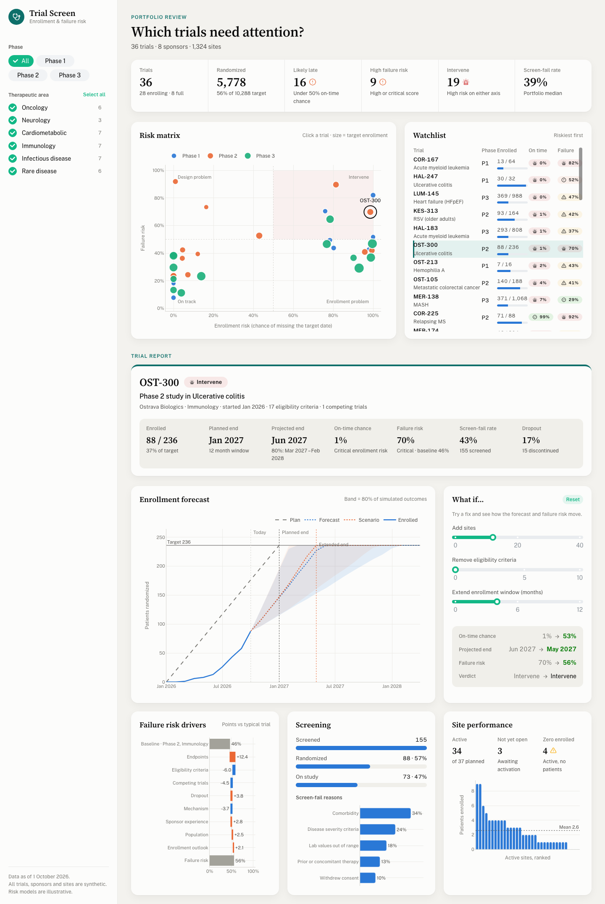

# Clinical Trial Risk Screen

A portfolio screen for clinical operations teams. It scores each trial on two
risks and shows which ones need attention:

- **Enrollment risk**: the chance of reaching the enrollment target by the
  planned end of enrollment, with a projected completion month
- **Failure risk**: the chance the trial terminates early or misses its primary
  endpoint, broken down into the factors that push it up or down

The app shows:

- **A portfolio summary** and a **risk matrix** that plots every trial on both
  risks, split into on track, enrollment problem, design problem and intervene
- **A watchlist** of trials, riskiest first. Click a row or a point to open the
  trial report
- **An enrollment forecast**: actual enrollment against plan, with the median
  projection and an 80% band from 2,000 simulated outcomes
- **What-if sliders** to add sites, remove eligibility criteria or extend the
  enrollment window, and see how the forecast, failure risk and verdict change
- **Failure risk drivers** as a waterfall from the phase and therapeutic area
  baseline to the trial's score
- **A screening funnel**, screen-fail reasons and per-site enrollment, including
  sites that are active but have enrolled no one

The data is synthetic. `trials.py` generates 36 made-up trials across six
therapeutic areas and three phases, with site activation delays, sites that
never enroll, and sponsors who plan with optimistic enrollment rates. The models
are illustrative, loosely shaped by published phase transition rates, not
fitted to real data.

Built with [Dash](https://dash.plotly.com/) and
[Dash Mantine Components](https://www.dash-mantine-components.com/).



## Running locally

Requires Python 3.13.

```bash
python -m venv .venv
source .venv/bin/activate
pip install -r requirements.txt
python app.py
```

Then open http://127.0.0.1:8050.

## Deploying to Plotly Cloud

The app exposes `server` for gunicorn (see `Procfile`) and the Python version is
pinned in `.python-version`. The portfolio is generated and scored once at
import, and projections are seeded by trial ID, so every worker shows the same
numbers.

## How the scores work

**Enrollment.** Each site's enrollment rate over the last six months is
blended with the rate expected for the trial design (therapeutic area,
eligibility criteria, competing trials, biomarker selection). Sites not yet
activated come online on schedule. The simulation draws a rate multiplier for
each path to reflect uncertainty, then draws monthly enrollment from a Poisson
distribution. The on-time chance is the share of paths that reach the target by
the planned end.

**Failure.** A logistic model starts from a baseline for the phase and
therapeutic area, then adjusts for eligibility criteria, endpoint count,
mechanism novelty, biomarker selection, sponsor experience, dropout, competing
trials and the enrollment outlook.

Verdicts: **On track** when both risks are low, **Watch** when either is
moderate, **Intervene** when either is high or critical.

## Using real data

Replace `build_portfolio()` in `trials.py` with a loader that returns `Trial`
objects from your CTMS or EDC: monthly randomizations, per-site activation
dates and counts, screening totals, screen-fail reasons and the protocol
features. The scoring and charts only depend on those fields.
