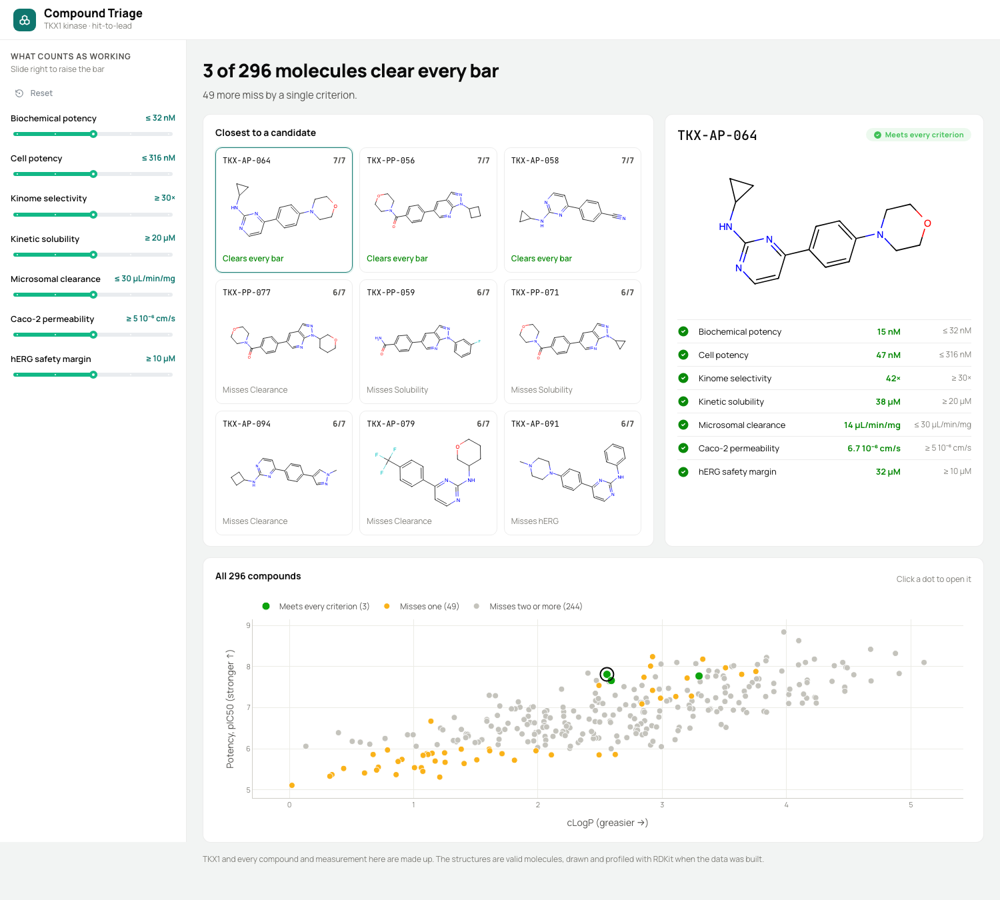

# Compound Triage

A hit-to-lead dashboard for a medicinal chemistry team working on a made-up
kinase target, TKX1. It answers the question a project team asks at every
design meeting: of the molecules we have made, which ones actually work, and
what is stopping the rest?

A compound "works" when it clears every bar in the target product profile:
biochemical potency, cell potency, kinome selectivity, solubility, microsomal
clearance, Caco-2 permeability and a hERG safety margin. Set each bar with the
sliders in the sidebar and the page updates.

The app shows:

- **How many molecules clear every bar**, and how many miss by just one
- **The compounds closest to a candidate**, drawn as 2D structures and ranked
  by how many criteria they meet, with what holds each one back
- **The selected compound**: a large structure and a checklist of each
  measurement against its bar
- **Every compound on a potency vs lipophilicity plot**, coloured by whether it
  meets every criterion, misses one, or misses more. Click a dot to open it

The data is synthetic. `scripts/build_data.py` builds 296 valid molecules by putting
R-groups on four kinase-like scaffolds, and computes their properties with
[RDKit](https://www.rdkit.org/). The assay results come from an additive model
(scaffold + R1 + R2 effects, plus noise) with realistic trade-offs: lipophilic
compounds are more potent but less soluble, cleared faster and more likely to
block hERG; basic amines add hERG risk; polar compounds lose permeability and
so lose potency in cells. As in a real project, only biochemically active
compounds were run in cells, and only cell-active ones were profiled for ADME
and safety, so many compounds are never measured on the later assays.

The deployed app does not need RDKit. The build script saves everything to
`data/compounds.json` and the structure drawings to `data/structures.json`,
and the app only reads those two files. To change the data, install
`requirements-dev.txt` and run `python scripts/build_data.py`.

Built with [Dash](https://dash.plotly.com/),
[Dash Mantine Components](https://www.dash-mantine-components.com/) and RDKit.

