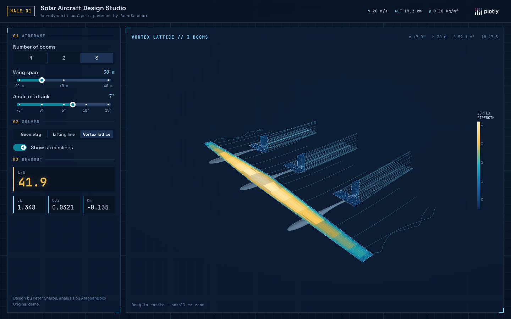

# Solar Aircraft Design with AeroSandbox

An interactive aerodynamic design tool for a high-altitude solar aircraft, built with
[Dash](https://dash.plotly.com/) and [AeroSandbox](https://github.com/peterdsharpe/AeroSandbox).
Original design and demo by Peter Sharpe
([AeroSandbox-Interactive-Demo](https://github.com/peterdsharpe/AeroSandbox-Interactive-Demo)).



## Features

- Change the number of tail booms, the wing span and the angle of attack; every change
  re-runs the analysis and redraws the aircraft in 3D.
- Three analyses:
  - **Geometry**: the full aircraft surface, with a quick AeroBuildup estimate.
  - **Lifting line**: panels colored by vortex strength, with viscous drag from
    NeuralFoil airfoil polars.
  - **Vortex lattice**: an inviscid panel solution (drag is induced drag only),
    optionally with flow streamlines.
- Lift coefficient, drag coefficient, lift-to-drag ratio and pitching moment for the
  cruise condition (20 m/s at 19 km, ρ = 0.10 kg/m³).

## Running locally

Requires Python 3.13.

```bash
pip install -r requirements.txt
python app.py
```

Then open http://127.0.0.1:8050. In production the app is served with gunicorn (see `Procfile`).

## Files

- `app.py`: layout, figures and callbacks
- `airplane.py`: the parametric aircraft geometry
- `assets/style.css`: the blueprint theme and single-viewport layout
