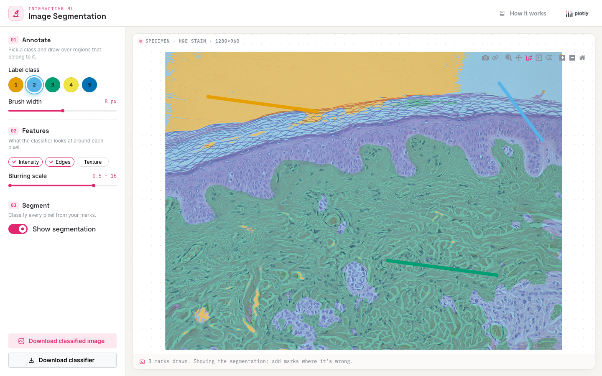

# Interactive Image Segmentation

Shows how Dash can be used to build an interactive machine learning app. Draw a
few marks on the image, using one color per kind of region, and a random forest
trained on the marked pixels classifies the rest of the image. Add more marks
where it gets things wrong and the segmentation updates.

Built with [Dash](https://dash.plotly.com/),
[Dash Mantine Components](https://www.dash-mantine-components.com/),
[scikit-image](https://scikit-image.org/) and
[scikit-learn](https://scikit-learn.org).



## Running locally

Requires Python 3.13.

```bash
python -m venv .venv
source .venv/bin/activate
pip install -r requirements.txt
python app.py
```

Then open http://127.0.0.1:8050.

## Deploying to Plotly Cloud

The app exposes `server` for gunicorn (see `Procfile`) and the Python version is
pinned in `.python-version`.

## Using a downloaded classifier

"Download classifier" saves the trained model as `classifier.json`. To segment
another image with it:

```bash
CLF_PATH=classifier.json \
IMG_PATH=path/to/image.jpg \
OUT_IMG_PATH=classes.png \
OUT_BLEND_PATH=blended.png \
python use_ml_image_segmentation_classifier.py
```

The classifier is stored as a pickle, so only load files you created yourself.

## Acknowledgements

Many thanks to Emmanuelle Gouillart for the image classifier training code.
