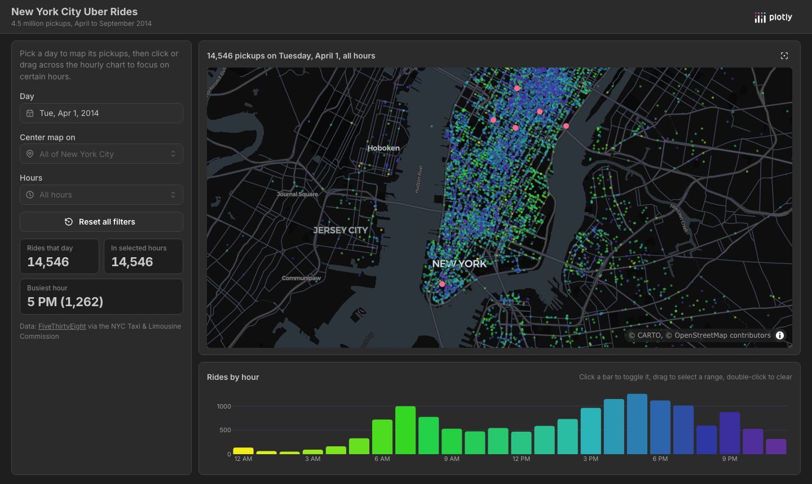

# New York City Uber Rides

An interactive map of 4.5 million Uber pickups in New York City from April to
September 2014, built with [Dash](https://dash.plotly.com/) and
[Dash Mantine Components](https://www.dash-mantine-components.com/).



## Features

- **Pickup map**: every pickup on the chosen day, colored by hour, on a dark
  MapLibre basemap (no Mapbox token needed).
- **Rides by hour**: click a bar to toggle that hour, drag across bars to select a
  range, or double-click to clear. The map and stats follow the selection.
- **Landmarks**: center the map on one of nine New York locations, or reset the view.
- **Stats**: total rides that day, rides in the selected hours and the busiest hour.
- **Reset**: one button returns the day, location, hours and map view to their defaults.

The whole dashboard fits in one screen on desktop and stacks on mobile.

## Project structure

```
app.py                     # Data loading, layout and callbacks
assets/style.css           # Page layout and styling
data/uber_rides.parquet    # Pickup time, latitude and longitude for every ride
```

The data comes from [FiveThirtyEight](https://github.com/fivethirtyeight/uber-tlc-foil-response),
obtained from the NYC Taxi & Limousine Commission. It is bundled as a compressed
Parquet file (15 MB) so the app starts quickly without downloading anything.

## Publish to Plotly Cloud

Upload all of the files in this folder to [Plotly Cloud](https://cloud.plotly.com).
Plotly Cloud installs the dependencies from `requirements.txt`.

## Run locally

Requires Python 3.13.

```bash
python -m venv .venv
source .venv/bin/activate  # Windows: .venv\Scripts\activate
pip install -r requirements.txt
python app.py
```

Then open http://127.0.0.1:8050.
