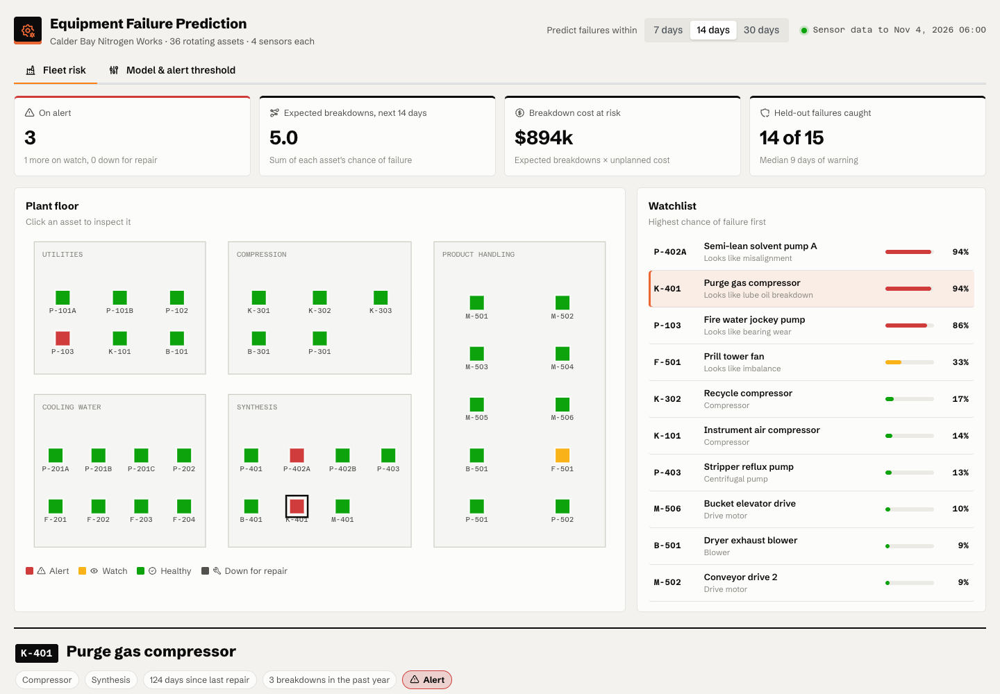

# Equipment Failure Prediction

Predicts which of the 36 pumps, compressors, cooling tower fans, blowers and drive motors at a made-up fertilizer plant (Calder Bay Nitrogen Works) are likely to break down in the next 7, 14 or 30 days, from hourly vibration, bearing temperature, motor current and outlet pressure.



## What's in it

**Fleet risk**
- A floor plan of the plant, with each asset colored Healthy / Watch / Alert by its chance of failure. Click an asset to inspect it.
- A watchlist ranked by risk, with the failure mode each asset's sensors look like.
- For the selected asset: its last 45 days of sensor readings against what a healthy unit reads at the same load and ambient temperature, the chance of failure at 7, 14 and 30 days, the likely failure mode and a recommended action, what is driving the prediction, and a year of predicted risk with past breakdowns marked.

**Model & alert threshold**
- Choose the alert threshold and enter your own breakdown, planned repair and crew-check costs.
- See how many of the held-out failures the rule would have caught, how much warning it gave, how many false alarms it raised and the net savings per year vs running to failure. "Use best threshold" picks the threshold that saves the most.
- What the model learned: the weight on each feature.

## The data and the model

Everything is synthetic and generated at startup in `plant.py` (fixed seed). Each asset runs with a daily load cycle, weekends, turndowns and seasonal ambient temperature. Failures follow a P-F interval: the asset starts to degrade 8–30 days before breaking down, and each failure mode leaves its own signature on the sensors. Bearing wear raises vibration and then temperature. Cavitation drops pressure and makes vibration erratic. Winding insulation faults raise current and temperature. About a fifth of failures come on suddenly with little warning, and some sensors drift without any fault behind them, so there are real misses and false alarms.

The model is an L2-regularized logistic regression written in numpy, with no ML library needed. It trains on the first eight months and is scored on the last four. Its features, built daily for each asset, are:
- how far each sensor sits from that asset's own load-corrected healthy baseline, and its 7-day change
- how erratic vibration is
- time since the last repair

## Run locally

```bash
pip install -r requirements.txt
python app.py
```

Then open http://127.0.0.1:8078.
