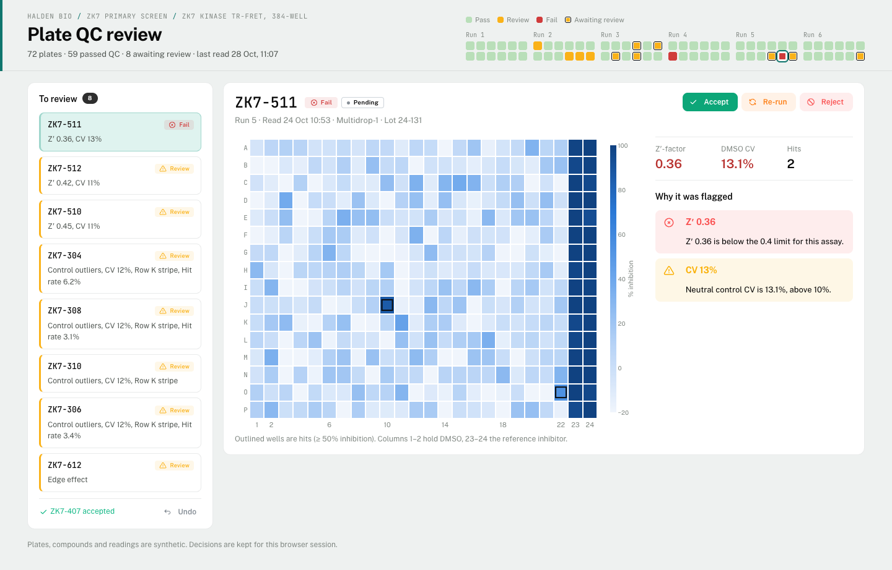

# Screening Plate QC

A quality control review app for a high-throughput screening campaign: 72
384-well plates, 23,040 compounds, read over six runs. It answers the questions a
screening scientist has before hits go to confirmation: which plates can be
trusted, which broke a QC rule and why, and are the hits on a plate real
chemistry or an artifact of the plate.

The app has three parts:

- **A strip of every plate in run order** in the header, colored by where it
  stands: accepted, awaiting review, sent for a re-run or rejected. Tiles
  change color as you make decisions
- **A to-review list** of the flagged plates nobody has decided on yet,
  failures first
- **The plate being reviewed**: its plate map in % inhibition with hits
  outlined, Z′, DMSO CV and hit count, why it was flagged in plain words, and
  buttons to **accept, re-run or reject** it

Deciding on a plate drops it from the list and opens the next one. A plate
sent for a **re-run** goes to an "In the lab" list with a countdown, and after
15 seconds (shortened for the demo) it comes back to the top of the queue as a
fresh read with the fault fixed. Real actives repeat; artifacts don't, so
ZK7-304's 20 row-K "hits" drop to none. Undo brings
the last plate back. Any plate can also be opened from the header strip, and a
decided plate can be sent back to the queue.

The app is stateless: decisions live in the page only, so refreshing starts
the review over from the full list. To keep them, write each decision to your
LIMS or a database in the `decide` callback.

## The data

The data is synthetic. `screening.py` generates a TR-FRET kinase assay with
DMSO controls in columns 1–2, a reference inhibitor in columns 23–24 and
compounds in 3–22, about 0.6% real actives, weak binders and a few fluorescent
compounds that read high. It plants the faults a screening lab actually meets:

| Fault | Where | What the QC sees |
| --- | --- | --- |
| Evaporation at the plate edge | last plates of run 2, last plate of run 6 | Edge effect |
| Clogged dispenser nozzle under-filling row K | run 3, Multidrop-2 | Row K stripe, high hit rate, control outliers |
| New detection reagent lot with a smaller window | runs 4–6 | Lower S/B in the controls chart |
| Reference inhibitor missing from half of column 24 | ZK7-407 | Negative Z′, robust Z′ still fine |
| Signal decay as plates wait for the reader | run 5 | Z′ falling through the run |

None of the QC code knows about these; every flag is computed from the well
values.

## QC rules

| Rule | Review | Fail |
| --- | --- | --- |
| Z′-factor | below 0.5 | below 0.4 |
| DMSO control CV | above 10% | |
| Control outliers (robust z > 4 within their group) | 2 or more | |
| Outer compound wells vs interior median | more than ±6% | |
| Median % inhibition of a row or column | beyond ±20% | |
| Hit rate (≥ 50% inhibition) | above 2% | |

Percent inhibition is normalised to the medians of each plate's own controls.
`screening.py` also computes robust Z′, signal-to-background and B-scores for
every plate if you want to show more.

Built with [Dash](https://dash.plotly.com/) and
[Dash Mantine Components](https://www.dash-mantine-components.com/).



## Running locally

Requires Python 3.13.

```bash
python -m venv .venv
source .venv/bin/activate
pip install -r requirements.txt
python app.py
```

Then open http://127.0.0.1:8050.

## Deploying to Plotly Cloud

The app exposes `server` for gunicorn (see `Procfile`) and the Python version is
pinned in `.python-version`. The campaign is generated with a fixed seed at
import, so every worker shows the same plates.

## Using real data

Replace `build_campaign()` in `screening.py` with a loader that returns `Plate`
objects from your plate reader exports or LIMS: a 16 × 24 array of raw values,
the compound ID in each well, and the run, read time, reader, dispenser and
reagent lot. `qc()` computes everything else. Change `HIGH_COLS`, `LOW_COLS`
and the thresholds to match your plate layout and SOP.
