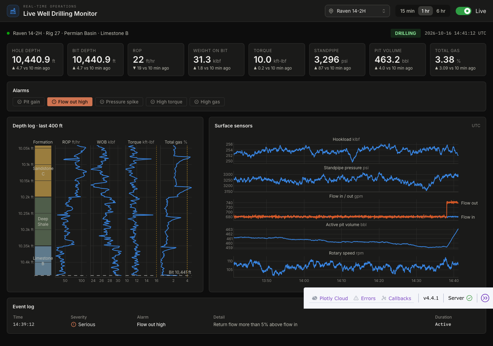

# Live Well Drilling Monitor

A real-time dashboard of the surface sensors a driller watches while drilling a
well. It updates every two seconds and shows:

- **Headline readings**: hole and bit depth, rate of penetration (ROP), weight
  on bit, torque, standpipe pressure, pit volume and total gas, each compared
  with ten minutes ago
- **Alarms** for pit gain, high return flow, pressure spikes, high torque and
  high gas, plus a log of every alarm raised in the selected time window
- **A depth log** of the last 400 ft drilled, with formation, ROP, WOB,
  torque and gas tracks
- **Strip charts** of hookload, standpipe pressure, flow in/out, pit volume and
  rotary speed over the last 15 min, 1 hr or 6 hr

The data is synthetic. `simulator.py` drills three made-up wells through a
stack of formations. Each run includes stand connections, circulating breaks,
stick-slip in hard rock, gas spikes after connections, and a few scripted kicks
(influxes) and pack-offs that trigger the alarms. Each well is simulated once at
startup as a 48 hour loop. The live position comes from the wall clock, so every
worker and browser tab sees the same moment.

Built with [Dash](https://dash.plotly.com/) and
[Dash Mantine Components](https://www.dash-mantine-components.com/).



## Running locally

Requires Python 3.13.

```bash
python -m venv .venv
source .venv/bin/activate
pip install -r requirements.txt
python app.py
```

Then open http://127.0.0.1:8050.

## Deploying to Plotly Cloud

The app exposes `server` for gunicorn (see `Procfile`) and the Python version is
pinned in `.python-version`. `--preload` runs the simulation once, before the
workers fork, instead of once per worker.

## Using real data

To connect a real rig feed (WITSML, a historian or a database), replace
`simulator.window()` and `simulator.live_index()` with functions that return
the same channels. The charts and alarms only depend on those arrays.
