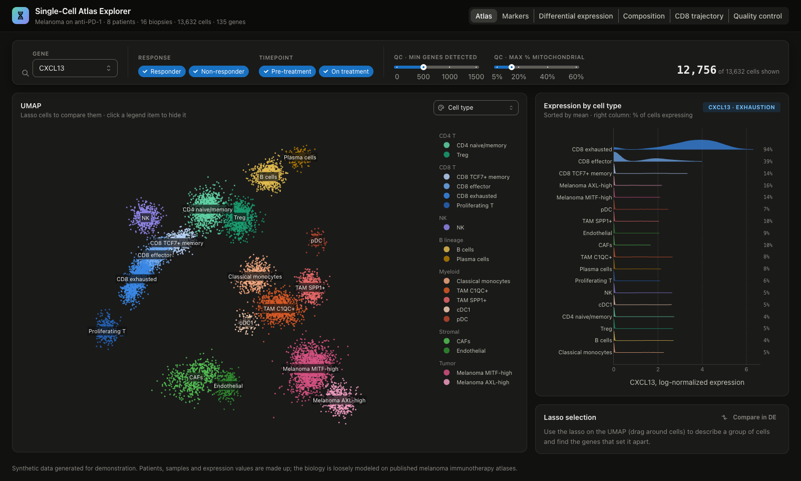

# Single-Cell Atlas Explorer

An explorer for single-cell RNA-seq results. The made-up study profiles tumor
biopsies from eight melanoma patients on anti-PD-1 therapy, four responders and
four non-responders, sampled before treatment and three weeks in. It covers
16 biopsies, about 13,600 cells and 135 genes.

The app has six views that share one set of filters (gene, response, timepoint
and QC thresholds):

- **Atlas**: a UMAP of every cell. You can color it by cell type, compartment,
  response, timepoint, patient, any gene, CD8 pseudotime or QC metrics.
  Next to it is a ridge plot of the selected gene across cell types. Draw a
  lasso on the UMAP to see what the selected cells are, which genes set them
  apart, and to send them to differential expression
- **Markers**: a dot plot of canonical markers, or the top markers computed for
  each cell type. Dot size is the % of cells expressing the gene and color is
  mean expression. Click a dot to select that gene everywhere
- **Differential expression**: compare responders with non-responders, on
  treatment with pre-treatment (paired by patient), one cell type with the rest,
  or a lasso selection with the rest. Shows a volcano plot, ranked gene tables
  and per-biopsy values for the selected gene
- **Composition**: each biopsy's cell-type mix as a heatmap. Click a cell type
  to see how its share changes on treatment for each patient
- **CD8 trajectory**: CD8 T cells on their path from TCF7+ memory to effector to
  exhausted. Shows where responders and non-responders sit along it, and how
  any gene rises or falls along pseudotime
- **Quality control**: genes detected, UMIs and mitochondrial reads per cell,
  with the thresholds that every other view applies. Also shows cells kept per
  biopsy, which flags one bad sample

The data is synthetic. `atlas.py` generates it at import from a fixed seed, so
every worker shows the same atlas. These patterns were built in, loosely based
on published melanoma immunotherapy atlases:

- Responders start with more TCF7+ memory CD8 T cells. On treatment they gain
  effector and proliferating T cells and cDC1s, and macrophages and tumor
  cells turn on an interferon response (CXCL9, CXCL10, STAT1)
- Non-responders gain exhausted CD8 T cells, Tregs, SPP1+ macrophages and an
  AXL-high tumor state that loses MHC class I
- About 5% of cells are low quality, and biopsy P06 on treatment is much worse
  than the rest

Built with [Dash](https://dash.plotly.com/) and
[Dash Mantine Components](https://www.dash-mantine-components.com/).



## Running locally

Requires Python 3.13.

```bash
python -m venv .venv
source .venv/bin/activate
pip install -r requirements.txt
python app.py
```

Then open http://127.0.0.1:8050.

## Deploying to Plotly Cloud

The app exposes `server` for gunicorn (see `Procfile`) and pins the Python
version in `.python-version`. The atlas builds in under a second and needs only
numpy.

## How the statistics work

**Comparisons between patients or timepoints** use pseudobulk. Each biopsy's
cells of the chosen type are averaged into one value per gene, and biopsies
with fewer than 10 such cells are skipped. Responders vs non-responders is a
Welch t-test on 4 vs 4 biopsies. On vs pre-treatment is a paired t-test within
patients. P-values are adjusted with Benjamini-Hochberg. Each biopsy counts
once, which avoids the false confidence you get from treating thousands of
cells from the same patient as independent.

**Cell type vs rest and lasso selection vs rest** are cell-level Welch
t-tests. With thousands of cells nearly every p-value is tiny, so the plot
shows fold change against the difference in % of cells expressing, which is
how marker tables are usually read.

**Highlighted genes** have an adjusted p below 0.05 and at least a 2-fold
change.

## Using real data

Replace `_build()` in `atlas.py` with a loader that returns the same dict from
an AnnData file: `obsm["X_umap"]`, log-normalized `X`, and `obs` columns for
cell type, compartment, sample, patient, response, timepoint, pseudotime,
`n_genes`, `n_counts` and `pct_mito`. For a full transcriptome, keep the
highly variable genes plus your markers so the matrix stays in memory, or move
the per-gene reads to a backed AnnData.
