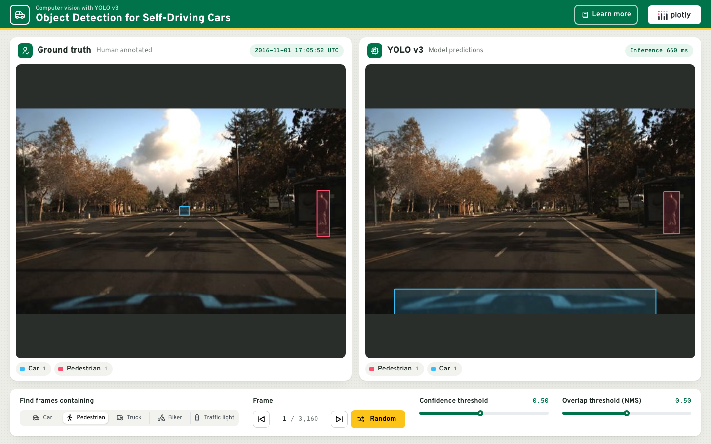

# Object Detection for Self-Driving Cars

Compare the human annotations of the
[Udacity self-driving car dataset](https://github.com/udacity/self-driving-car/tree/master/annotations)
with the objects a [YOLO v3](https://pjreddie.com/darknet/yolo/) network finds
in the same dashcam frame. Pick an object class to browse frames containing it,
step through them or jump to a random one, and tune the model's confidence and
overlap (non-max suppression) thresholds.

Built with [Dash](https://dash.plotly.com/),
[Dash Mantine Components](https://www.dash-mantine-components.com/) and
[OpenCV](https://opencv.org/).



## Running locally

Requires Python 3.13.

```bash
python -m venv .venv
source .venv/bin/activate
pip install -r requirements.txt
python app.py
```

Then open http://127.0.0.1:8050.

On first start the app downloads the YOLO v3 weights (~250 MB) in the
background to `~/.cache/dash-self-driving/`, outside the project folder so they
are never uploaded. Until then the YOLO panel shows the frame with the download
progress, and the predictions appear by themselves once the model is loaded.
Frames are fetched from `images.plot.ly` as they're viewed.

## Deploying to Plotly Cloud

The app exposes `server` for gunicorn (see `Procfile`) and the Python version is
pinned in `.python-version`. A single worker holds the network in memory and
serves requests with threads. The weights are downloaded at startup, so they
don't need to be published with the app.

## Notes

- OpenCV is pinned to the 4.x series: OpenCV 5 removed support for Darknet
  models.
- YOLO runs once per frame and its candidate detections are cached, so moving
  the threshold sliders is instant.
- `Exploration.ipynb` is the notebook the app was originally prototyped in.
