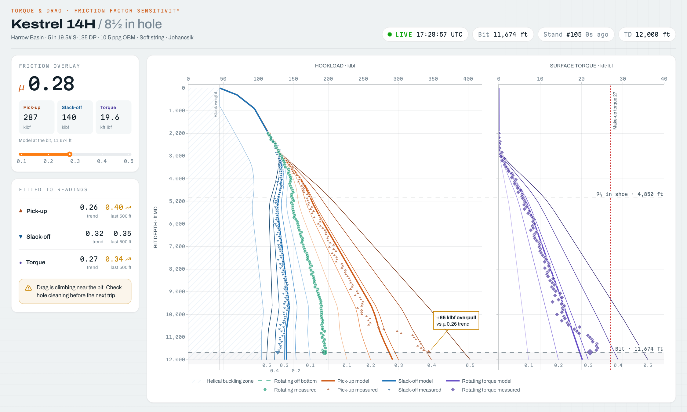

# Torque & Drag Broomstick

A live torque and drag chart for one 8½ in drilling section, the plot a
drilling engineer uses to tell how much friction the hole is showing. Hookload
and surface torque are plotted against bit depth, and the page refreshes every
two seconds as the bit drills ahead:

- **The broomstick**: model curves for pick-up (copper), slack-off (blue) and
  rotating torque (violet) at friction factors from 0.1 to 0.5
- **Rig readings** every two stands: pick-up, slack-off, rotating off-bottom
  weight and torque, laid over the fan so the friction factor can be read off
- **Friction overlay**: a slider that draws the model at any friction factor
  between 0.10 and 0.50, with the predicted loads at the current bit depth
- **Live status**: bit depth, the latest stand and how long since its reading;
  the newest readings are drawn larger and the latest pick-up is called out
- **Fitted friction factors** for the trend and for the last 500 ft, recomputed
  as each reading lands, flagging drag that is climbing (a tight hole from
  10,250 ft)
- **Limits**: the helical buckling zone for slack-off and the drill pipe's
  make-up torque, plus the casing shoe and current bit depth

The data is synthetic. `tnd.py` runs a soft-string (Johancsik) model along a
made-up build-and-hold well, then generates the rig readings from the same
model with known friction factors and noise. The bit drills from 8,000 ft to
near TD over a 15 minute loop. Its position comes from the wall clock, so every
worker and browser tab sees the same moment.

Built with [Dash](https://dash.plotly.com/) and
[Dash Mantine Components](https://www.dash-mantine-components.com/).



## Running locally

Requires Python 3.13.

```bash
python -m venv .venv
source .venv/bin/activate
pip install -r requirements.txt
python app.py
```

Then open http://127.0.0.1:8050.

## Deploying to Plotly Cloud

The app exposes `server` for gunicorn (see `Procfile`) and the Python version is
pinned in `.python-version`.

## Using real data

Replace `tnd.GRID` with your T&D software's output (hookload and torque by bit
depth for each friction factor) and `tnd.MEASURED` with the rig's pick-up,
slack-off, rotating weight and torque readings, and `tnd.live()` with the
current bit depth from your rig feed. The chart only depends on those.
