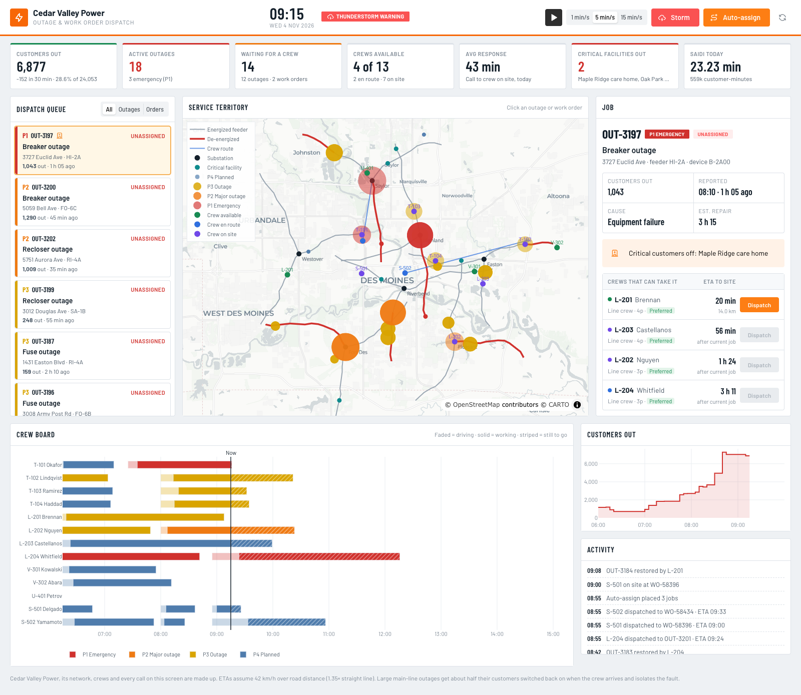

# Outage & Work Order Dispatch Console

A dispatcher's console for one shift at **Cedar Valley Power**, a made-up electric utility.
Trouble calls arrive as outages while planned work orders wait in the same queue. Pick a
job, see who it affects and which crews could get there soonest, dispatch one, and watch
the crew drive out, switch customers back on and close the job. The clock runs on its own,
and a thunderstorm is rolling through when the shift opens.



## What it shows

- **KPI strip**: customers out (and the change over the last 30 minutes), active outages and
  P1 emergencies, jobs waiting for a crew, crews available, average call-to-on-site response,
  critical facilities without power, and SAIDI minutes accrued today.
- **Dispatch queue**: every open job, ordered by priority. Unassigned work comes first, then
  the most customers out, then the oldest. P1 = wire down or critical customer (hospital,
  water pumping, care home) affected. P2 = 500+ customers. P3 = other outages.
  P4 = planned work, bumped up when it is due within two hours.
- **Service territory map**: substations and feeders, de-energized sections of feeder in red,
  outages sized by customers out, critical facilities, crews coloured by status and the route
  of every crew on the road. Click a job to select it.
- **Job panel**: customers out, cause, repair estimate, hazard and critical-customer alerts,
  and the crews that can take it, ranked by ETA to site (busy crews show when they could get
  there after their current job, and an overtime flag shows if the job would run past 18:00).
  Dispatch a crew, or recall one that is still driving.
- **Crew board**: a Gantt chart of each crew's day: driving, working, and the estimated work
  still to go.
- **Customers out** over the shift and an **activity log**.

## Controls

| Control | What it does |
| --- | --- |
| Play / pause | Runs the sim clock (one tick a second) |
| 1 / 5 / 15 min/s | Sim minutes per tick |
| Storm | Turns storm mode on or off (about 4× the outage rate, more tree and lightning faults). The opening storm ends at 10:30 on its own |
| Auto-assign | Gives each unassigned job, highest priority first, the soonest available crew that can do it within 75 min |
| Reset | Starts the shift over at 07:30 |

## How the simulation works

`dispatch.py` builds a fixed network (7 substations, 21 feeders, ~24k customers) and a
roster of 13 crews across five skill types. Shift state lives in a `dcc.Store` as plain JSON
and is advanced by pure functions, so the app works with several gunicorn workers.

- Outages arrive as a Poisson process. Breaker and recloser faults take out everything
  downstream on the main line; fuse and transformer faults are smaller laterals.
- ETAs use straight-line distance × 1.35 at 42 km/h.
- When a crew reaches a main-line outage with more than 300 customers out, it isolates the
  fault and switches about 55% of them back on before the repair.

All names, places, crews and calls are synthetic.

## Run it

```bash
pip install -r requirements.txt
python app.py
```

Then open http://127.0.0.1:8052.
