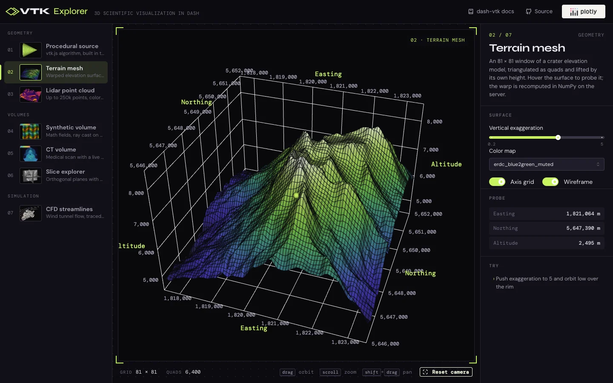

# VTK Explorer

A gallery of eight interactive 3D scenes built with
[dash-vtk](https://dash.plotly.com/vtk), each driven from Python and rendered in
the browser with vtk.js:

- **Procedural source**: a cone, cylinder or sphere generated client side from a
  few parameters, so no mesh is sent at all
- **Terrain mesh**: a crater elevation model warped by its own height, with
  hover picking, an axis grid and a vertical exaggeration slider
- **Lidar point cloud**: up to 250,000 aerial lidar returns colored by elevation
- **Synthetic volume**: gyroid, nested shells or noise fields computed in NumPy
  and ray cast on the GPU, with vtk.js's transfer function editor
- **CT volume**: a head CT read with VTK and volume rendered
- **Slice explorer**: three orthogonal planes through the full-resolution CT,
  with window and level
- **CFD streamlines**: airflow around a motorbike from an OpenFOAM run, traced
  through the velocity field with VTK on the server
- **Vehicle aerodynamics**: a race car from an OpenFOAM run, colored by surface
  pressure or velocity, with a wake isosurface and a hover probe

The whole app fits one screen: scenes on the left, the viewport in the middle and
each scene's controls on the right.

Built with [Dash](https://dash.plotly.com/),
[dash-vtk](https://github.com/plotly/dash-vtk) and
[Dash Mantine Components](https://www.dash-mantine-components.com/).



## Running locally

Requires Python 3.13.

```bash
python -m venv .venv
source .venv/bin/activate
pip install -r requirements.txt
python app.py
```

Then open http://127.0.0.1:8050.

## Deploying to Plotly Cloud

The app exposes `server` for gunicorn (see `Procfile`) and the Python version is
pinned in `.python-version`. All data ships in `data/`, so nothing is downloaded
at startup, and only headless VTK modules are imported, so no system OpenGL
libraries are needed on the server.

## Project layout

- `app.py`: the shell, navigation and routing
- `demos/`: one module per scene, each exposing `view()`, `controls()` and
  `stats()` and registering its own callbacks; `demos/__init__.py` sets the order
- `data/`: the CT volume, the CFD meshes, the race car parts with a decimated
  copy of its isosurface, and pre-sampled copies of PyVista's
  lidar and crater example datasets
- `assets/style.css`: the theme

## Acknowledgements

The head CT, motorbike CFD case, race car case and the lidar and crater datasets come from the
[dash-vtk](https://github.com/plotly/dash-vtk) and
[PyVista](https://docs.pyvista.org/) example collections.
