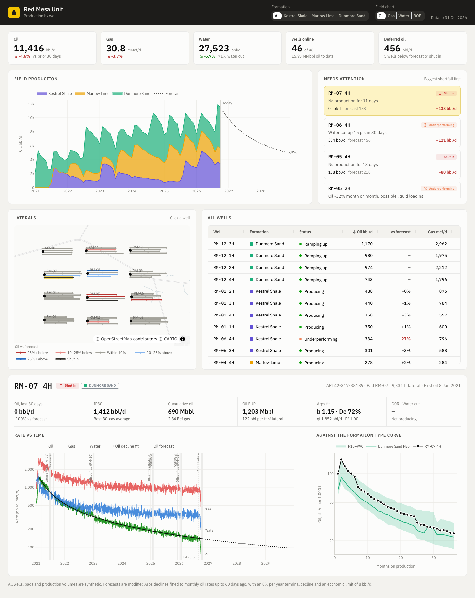

# Well Production Tracker

A production surveillance dashboard for the 48 horizontal wells of an oil
field. It answers the questions a production engineer asks each morning:
how much is the field making, which wells are falling short of their decline
curve, and why.

The app shows:

- **Field totals** for oil, gas, water, wells online, and the oil being
  deferred by shut-in and underperforming wells
- **Field production by formation**, stacked by month, with a two-year forecast
  built from each well's decline curve. Switch the stream between oil, gas,
  water and BOE
- **A needs-attention list** of shut-in and underperforming wells, ordered by
  shortfall in bbl/d, with a likely cause: rising water cut, a fast drop that
  points to liquid loading, or no production
- **A map of the laterals**, each colored by how its last 30 days compare with
  its forecast
- **A sortable table of every well**: rates, variance to forecast, water cut,
  GOR, cumulative oil and EUR
- **A rate-time chart for the selected well**: daily oil, gas and water on a
  log scale, the Arps decline fit and forecast, and shaded downtime (workovers,
  offset frac shut-ins, pump failures)
- **The well against its formation type curve**: oil per 1,000 ft of lateral
  by month on production, with P10–P90 band and P50

Click a well on the map, in the table or in the attention list to open it.

The data is synthetic. `wells.py` generates 12 pads of 4 wells in three made-up
formations, with formation-specific decline parameters, choke-managed ramp-up,
rising gas-oil and water-oil ratios, random downtime, frac hits on neighbouring
pads, and a few wells that develop a problem in the last two months.

Built with [Dash](https://dash.plotly.com/),
[Dash Mantine Components](https://www.dash-mantine-components.com/) and
[Dash AG Grid](https://dash.plotly.com/dash-ag-grid).



## Running locally

Requires Python 3.13.

```bash
python -m venv .venv
source .venv/bin/activate
pip install -r requirements.txt
python app.py
```

Then open http://127.0.0.1:8051.

## Deploying to Plotly Cloud

The app exposes `server` for gunicorn (see `Procfile`) and the Python version is
pinned in `.python-version`. The field is generated with a fixed seed and fitted
once at import, so every worker shows the same numbers.

## How the forecasts work

Each well's monthly average oil rate on producing days is fitted with an Arps
hyperbolic decline (grid search over b and Di, qi solved in log space), skipping
the first 45 days of ramp-up. The fit uses data up to 60 days ago. The last 30
days are then compared with what the fit predicted, which is the variance shown
throughout the app. A well more than 15% below forecast is flagged as
underperforming.

The decline switches to exponential at 8% per year, and EUR is cumulative oil
plus the forecast down to an economic limit of 8 bbl/d, capped at 30 years.
Wells with less than four months of history take the median b and Di of their
formation, scaled to their recent rate. Gas and water forecasts extend each
well's gas-oil and water-oil ratio trend from the last year. Shut-in wells are
forecast at zero until they're back online.

## Using real data

Replace `build_field()` in `wells.py` with a loader that returns `Well` objects
from your production accounting system or historian: daily oil, gas and water
volumes, first production date, lateral length, formation, heel and toe
coordinates, and downtime events. The fitting, flags and charts only depend on
those fields.
